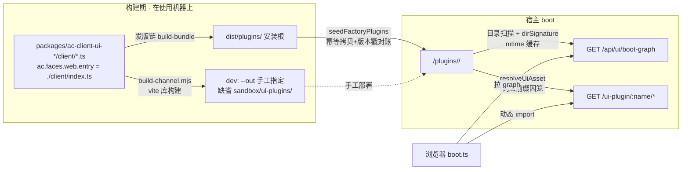

# 插件包自持 web 产物与原位服务（ui-plugin-selfhost）

> 性质：探索档案——插件包自持 web 产物与原位服务的诊断与产物裁决。
> 状态：**已被取代**（cr-923 webui-v3——装载锚点重造；本档只治产物住哪、未动锚点，方向不足）· cr-1008 2026-11-11 整理批检阅归位。
> 读者：追溯 webui 装载锚点演进时才需要（现行口径以 webui-v3.md 为准）。

> cr-919（2026-11-06）探索立档——plugin-architecture-v2（cr-901）§4.3
> web 面统一通道的下一批演进方向；ui-plugin-form.md（cr-905）四切片
> 的后继。状态 = **已被取代**（cr-923 webui-v3——装载锚点重造，本档只治
> 产物住哪、未动锚点，方向不足；保留为诊断与产物裁决的出处）。
> 原「提案（未立项实施；裁决条目为方向锁）」语义随 cr-923 终止。参照系 = DSH 实物（证据路径见 §二）。
> 规范用语同 cr-901：**必须 / 禁止 / 仅可** = 强制；偏离须先改本档。
> ****2026-11-06 审计修订**（未编号）**：补绘 §〇架构图；修正 §一诊断两处
> 失实；裁决一改「显式产物词形」（对标 dsh.client）；裁决二锚定 v2
> §4.3 row-catalog 退役裁决；裁决四签名面整体退役（不做内容哈希，
> dev 新鲜度转 HMR 通知帧）；防穿越升级 realpath 囚笼；切片验收改
> 版本/哈希清单等值（弃逐字节）；standalone 必要性转待裁决（§六.4）。
> 再修（同日）：构建器唯一化（`--out` 出参整体退役，无第二条构建
> 路线）；切片一二并批单 CR（原稿「部署口保留窗 / 旧路径赢」等于
> 复活部署链、否决 cr-905/920，弃）；原位读恒赢，数据根 `plugins/`
> 仅为第三方物化位本义。

## 〇、webui 架构图（现状 → 目标）

### 现状：部署态耦合（**今日事实 = 本档否决对象，非提案**）



病根：产物是**宿主部署态**（数据根副本），不是包的自我管理物——
同一产物包内（源）/数据根（件）异地两份，目录扫描 + mtime 签名承重，
`plugins/` 出厂件与第三方物化双职（§一）。

### 目标：包自持 + 原位服务

```mermaid
flowchart LR
  subgraph 构建器[唯一构建器 build-channel.mjs · 无第二条路线]
    SRC2[packages/ac-client-ui-*<br/>client/*.ts 源] -->|dev 直调 · 发版 CI 调<br/>同一脚本同一产物位| DIST[client/dist/index.js<br/>预构建产物随包走<br/>不入 git]
  end
  subgraph 宿主boot2[宿主 boot · 零拷贝]
    ROWSET[行集求值<br/>webui 基座源文档 − custom 停用<br/>∪ installed(scope:webui)] -->|行名解析包位置<br/>link: / npm（cr-908 先例）| PKGROOT[包根定位<br/>dev = repo 原位 / bundle = 安装根<br/>installed = 物化位]
    PKGROOT -->|读 package.json<br/>ac.faces.web 唯一 manifest| GRAPH2[GET /api/ui/boot-graph<br/>每请求重算 · 无签名缓存]
    PKGROOT -->|resolveUiAsset v2<br/>realpath 囚笼 + ETag/304| ASSET2[GET /ui-plugin/:name/*]
  end
  BROWSER2[浏览器 boot.ts] -->|拉 graph version diff| GRAPH2
  BROWSER2 -->|动态 import| ASSET2
  DEV[dev: build-channel watch] -->|通知帧 对齐 dsh-client-hmr| BROWSER2
```

构建器**唯一**（dev 与发版链调同一脚本，产物恒落包内 `client/dist/`——
不存在「部署口」概念）；数据根 `plugins/` 仅为第三方 installed 物化位
（v2 §4.2 本义，非回落——出厂件从不在场），boot graph 与资产路由
同源 = 行集解析的包根。

## 一、诊断：现行通道的部署态耦合

现行 web 面已完成统一通道收口（cr-905：channelImports 退役、分层
求值、包形态装载），但**产物是宿主部署态，不是包的自我管理物**：

- **构建在使用侧**：工厂 web 件由 `build-channel.mjs`（vite 库构建）
  在使用机器上跑。~~缺省产物落数据根~~ **cr-921 修正**：缺省 out =
  `sandbox/ui-plugins/`（数据根隔离红线已在）；落数据根是 `--out`
  手工误用面 + bundle 链 `dist/plugins → seedFactoryPlugins` 拷贝。
  忘部署即整面降级（无件空图）。
- **拷贝两重**（~~三重~~ cr-920 已退役 channel/ 生成壳，源单源 =
  包内 client/ 源码）：bundle 形态 `seedFactoryPlugins` boot 期幂等
  拷贝 + 每代升级重拷版本戳对账；dev 手工 `--out`。产物在包内（源）
  与数据根 `plugins/`（件）异地两份。
- **生效面锚在目录**：boot graph = `pluginsDir` 目录扫描 + mtime
  签名（`dirSignature`——签名还须纳管分层文档 mtime，缓存失效面
  越滚越大）。
- **目录语义双职**：`plugins/` 既是出厂件部署位又是第三方物化位
  （plugin-architecture-v2 §五 的同名两义矛盾）。

根因：**构建与产物归属错位**——浏览器吃不了 TS/Vue（该裁决不动），
但「谁来构建、产物住哪」answer 成了宿主部署链，而 DSH 的答案是
**包作者/发布链构建，产物随包走，宿主原位服务**。

## 二、参照系（DSH 实物证据，2026-11-06 实测）

桌面运行时 `app.asar\dsh\node_modules\@deepseek-ai/*`（npm CLI
0.2.0-rc.2 同源样本）：

| 机制 | DSH 实物 | 证据 |
|---|---|---|
| 双面包装 | node 半边 `lib/index.js`（2.6KB 普通 cordis 插件）+ `lib/client.js`（565KB 预构建浏览器 bundle，随 npm 包分发） | `dsh-client-ui-chat` |
| 声明 | `package.json` `dsh.client`：inject/external/platform/immediately | 同上 |
| 壳服务 | `frontend-static` 插件从安装位置直读 dist（`distIndex` 配置注入；零拷贝、防穿越 403） | `dsh-host-frontend-static/lib` |
| 装载合成 | `dsh-client-modules` 扫**宿主 Loader 已装载 entries** 中带 `dsh.client` 者 → 合成 `window.__DSH_BOOT__` 模块图 → combo 路由注入 index | `dsh-client-modules/lib` |
| 浏览器运行时 | lazy CJS 表：bundle 执行只注册 factory，首 import 才物化；共享依赖走种子词 → shell 活实例 | 同上 |
| dev 热更 | `dsh-client-hmr`（node 半边注册/通知面） | 包在列 |

要点一：DSH 同样「直读包」，但直读的是**随包发布的预构建 JS**——
构建步没有消失，被推到发布时；宿主读 loader 解析到的包位置（install
根 node_modules / profile link:），一律原位服务，**数据根零产物副本**。

要点二（cr-921）：**「manifest 住 package.json + entry 显式指预构建
产物」是可扩展 webui 的现代常规做法**——VS Code（`contributes` +
`main` 指 bundle）、DSH（`dsh.client` + `lib/client.js`）、浏览器
扩展（manifest.json + build 输出）、Module Federation（`exposes` +
构建产物）同构：声明即承诺「发布链已构建」，宿主只发现与原位装载。
本档裁决一据此对齐。

## 三、目标形态（方向裁决）

- **裁决一：web 产物随包自持，entry 显式指产物**。`ac.faces.web.entry`
  指**包内预构建产物**——词形**显式变更**：`./client/index.ts`（源，
  构建输入）→ `./client/dist/index.js`（产物，装载输入），全仓
  ac-client-ui-* 同批切换。**package.json = 唯一 manifest**（`ac`
  字段单源，同 node 面；manifest.json 迁移投影随切片二退役）。
  工厂件构建归发版链（CI 出产物随包/随安装根），第三方件归作者
  （`ac plugin publish` 前置构建档——v2 §九.2 可选构建档对 web 面
  转为必需）。**`build-channel.mjs` = 唯一构建器**：dev 直调与发版
  链 CI 调同一脚本，产物恒落包内 `client/dist/`；`--out` 出参
  **整体退役**——不再存在「部署口」概念，部署态拷贝链无再生路径。
- **裁决二：原位服务，定位源 = 行名解析**。webui 资产路由与 boot
  graph 的定位源从「扫 `pluginsDir`」改为「**行集求值 → 行名解析包
  位置 → 包目录直读**」。行名解析依 v2 §4.2（`name` 定位：npm →
  安装根解析；link:/目录 → 原址或物化位）——**v2 §4.3 已裁决
  row-catalog.json 退役，基座源文档（repo 内 webui.patch.yml）= 行→
  包映射单一事实源**；installed 行 link:/npm 解析已有 cr-908 批六
  先例。出厂行经基座源文档 name 解析得包根（dev = repo 原位；
  bundle = 安装根），路由按包根囚笼。`seedFactoryPlugins` 播种面
  **退役**。
- **裁决三：数据根 `plugins/` 收窄为 installed 物化位**（第三方目录
  /npm 形态落位），出厂件**永不进数据根**。plugin-architecture-v2
  §五 同名两义矛盾随之消解；备份口径（lock + patch + `plugins/`
  随行）与 v2 §五目标态对齐——**ac-backup 旧代插件不在本批处理**，
  其随行假设待该域自身收口时复核（§六.6）。
- **裁决四：签名面退役，新鲜度分层承担**。`dirSignature`（mtime
  缓存）退役；boot graph **每请求直接重算**（输入 = N 份包
  package.json + 分层文档，读盘成本 ≪ 资产服务，无缓存失效面）。
  资产新鲜度由既有 serveFileRoute ETag/304 协商承担（字节不变免传）。
  **不做行内容哈希**（重算成本与缓存键自指两难）。dev 循环新鲜度 =
  **通知帧热更**（对齐 `dsh-client-hmr`：watch 重建产物 → 宿主通知
  → 前端重拉 graph + 模块 `?t=` 穿透——repo 内 `ac plugin dev` 会话
  级 `?t=` 穿透已是先例），归切片三。审计视图（boot-graph /
  warnings）不变。
- **不动面（修正版）**：统一通道与零特权路径（工厂/第三方同路由同
  词法）；宿主模块表 external 全表恒等；seats / isolated 词形；**webui
  分层求值语义**（基座 − custom 停用 ∪ installed、点名缺席降级语义）
  ——输入源从目录扫描改为行集解析**是本档改动面**（审计修正：
  原稿误将「webui 分层合成」整体列入不动面，自相矛盾）。
- **待裁决：webui 独立部署（standalone）**——见 §六.4。

## 四、与既有文档的关系

- plugin-architecture-v2 §4.3「工厂件 TS/Vue→JS 构建步保留，产物走
  统一通道」——**裁决不变，注脚升级**：构建步的归属从部署侧移到
  发布侧，通道承载物从「部署副本」变「包内产物」。
- ui-plugin-form.md 四切片全部保留为地基（模块表单源 / channelImports
  退役 / 分层求值 / 包形态装载）；本档只改**产物的家**。
- §4.2 多物化形态表、§4.7 进程注册表：零冲突；§4.5 分轨指纹——
  web 面不新增指纹面（裁决四）。
- webui-standalone-protocol.md（cr-912/cr-917）：待 §六.4 裁决。

## 五、迁移切片（立项时逐片 CR，含验收/开关/回滚——原位读恒赢，无双读窗口）

1. **产物落位 + 原位读切换（同一 CR 并批——无中间态，无部署口保留窗）**：
   - 产物契约：目录 = `<pkg>/client/dist/`；entry 全仓切 `./client/
     dist/index.js`（32 包 package.json 词形切换；readChannelManifest
     package 形态已是主读路径——package.json 即 manifest，零派生）；
     `.gitignore` 加 `packages/*/client/dist/`；npm 发包 `files` 字段
     含 `client/dist`；发版链 CI 调 build-channel 出产物随行（同脚本
     同产物位，无第二条构建路线）；`--out` 出参随本切片退役。
   - 同 CR 切读取源：webui-row 资产路由 + boot graph 求值切行集
     原位读；`resolveUiAsset` 升级 realpath 囚笼。**原位读恒赢**——
     出厂行从不读数据根（存量出厂副本即死数据，切片二清理）；
     数据根 `plugins/` 只服务 installed 第三方行（物化位本义）。
     回滚 = 整 CR revert（产物位与读取源同进同退，无半切换态）。
   - 验收：装配链 e2e 全量；新旧源**语义等值判据 = manifest
     version + entry 构建戳 + 文件 SHA-256 清单（差异白名单制）**
     ——不逐字节（两次构建环境差异天然存在）；**出厂行解析失败 =
     fail-loud 警告上报，第三方行 = 降级跳过**——两语义区分。
   > **前置已落（cr-920，2026-11-06）**：通道壳退役——web 面声明已归
   > packages/ac-client-ui-*/package.json `ac.faces.web`，build-channel
   > 直构包源（含外部化不变量门），channel/ 生成壳与 gen-domain-channels
   > 退役；产物仍落部署位（out 目录），「产物住包内」留给本切片本体。
2. **退役面收口**：`seedFactoryPlugins` / `dirSignature` /
   build-bundle `dist/plugins` 拷贝链 / manifest.json 迁移投影退役；
   realpath 囚笼细则（root 与 file 各 realpath 后前缀对拍；包根内
   符号链接允许、解析出包根外 = 403）与撞名防御（装配层门禁为主，
   graph 层防御性警告跳过后者）随本切片测试锁定。出厂行原位读
   失败语义（fail-loud 上报）同批固化。
   `plugins/` 收窄 installed；plugin-architecture-v2 §五 改义 + 备份
   口径更新；存量数据根出厂副本清理（复用 cr-918 数据根收口手法）。
   升级代际混跑天然免疫（原位读恒赢——数据根残留出厂副本从不被
   读取），本切片物理清理。验收：数据根无出厂件、boot 等值、备份演练通过
   （备份面 = v2 §五 规范口径；ac-backup 实现属旧代插件，不在本批）。
3. **dev 热更（可选后继）**：通知帧热更对齐 `dsh-client-hmr`——
   node 半边 watch 重建产物 + 变更通知，前端重拉 graph + 模块 `?t=`
   穿透；combo 合并路由与按需分块（对齐 DSH `comboUrl`）独立立项。

## 六、风险与开放问题

1. **产物入库/发包策略**：工厂件产物不入 git（洁净）则 clone 后首跑
   需构建步（dev 工具已在）；npm 形态第三方件产物入包体（DSH 同款
   常态，包体膨胀可接受——v2 §九.2 开放项对 web 面转为必需构建档）。
2. **防穿越与 MIME**：realpath 囚笼（切片二）；MIME 白名单扩表先行
   登记产物实际面（.map/.woff2/.wasm 等——现 CONTENT_TYPES 缺口，
   缺省 octet-stream 不可作长期语义）；combo/sourcemap 路由若做，
   白名单词法先行。
3. **行解析失败语义**：`link:` 路径失效 = 警告 + 跳过 + 上报（降级
   语义与点名缺席同款），**禁止**阻断 boot；**出厂行缺席/解析失败 =
   fail-loud 上报**（区别于第三方降级——出厂面漂移是发布链 bug，
   不是用户态）。
4. **webui 独立部署（standalone）必要性——待裁决（2026-11-06 提出）**：
   cr-912 立档、cr-917 切片一已实施四层地址发现 + hello 握手（现存
   面：`webui-standalone-protocol.md` / `apps/ui/client/host-endpoint.ts`
   / webui-row hello 端点 / 两处测试）。但独立部署场景（远程宿主、
   离线 PWA）尚无实际消费方，协议轴版本协商是持续维护成本；且原位
   读对远端宿主提出「宿主进程可达包位置」的新要求。**倾向：移除
   已实施内容、协议文档归档挂起，待真实场景再立**（v2 §4.7 相应
   裁决随判）。待用户裁决后定切片。
5. **Windows link 跨盘 / 私域 registry**：承 v2 §九.5 既有开放项。
6. **ac-backup 旧代插件**：备份随行 `plugins/` 的实现假设不在本批
   处理——本批只落 v2 §五 规范口径；该域收口时按裁决三复核
   （`plugins/` = 纯用户自装件）。