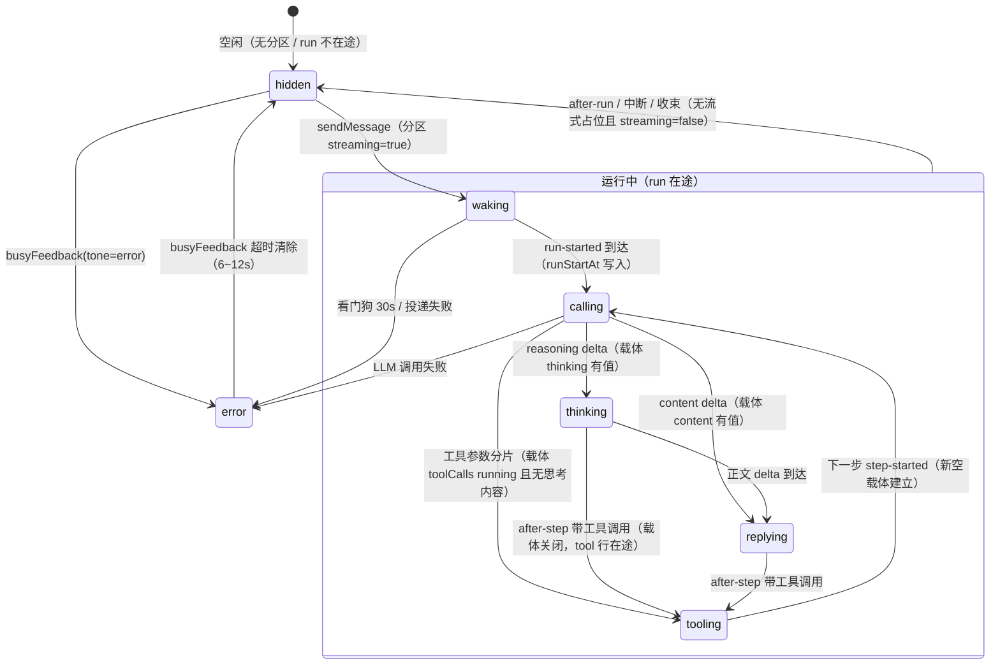

# run-status 状态机（cr-744/749/751）

## 状态机图（Mermaid）



## 判据表（deriveRunStatus 求值序——自上而下首个命中）

| 序 | 判据 | 状态 | 说明 |
|---|---|---|---|
| 0a | busyFeedback≠'' && busyTone=error | error | 投递失败/看门狗超时（并入，用户裁决） |
| 0b | authoritativeActive=false 且静默>20s | hidden | 【权威判死】cr-756：shell conversation/stats 确认不在跑 + 本地无新帧 = 死行收束；新帧到达即恢复本地自治（豁免窗对齐悬挂探针口径；RPC 失败不定罪） |
| 1 | !d || !runInFlight(d) | hidden | runInFlight = streaming 或 存在 isStreaming 占位（组合判据——边界帧丢失窗口不漏判） |
| 2 | 载体 content 有值 | replying | 正文流式输出中 |
| 3 | 载体 thinking/reasoning 有值 | thinking | 思考流中（工具参数分片并行期仍 thinking——载体优先） |
| 4 | 载体 toolCalls 有 running/preparing | tooling | 模型生成工具参数（preparing 卡、无思考内容时） |
| 5 | 载体存在但全空 | calling | step-started 已建占位、首 delta 未到（TTFT / 思考 chunk 间隔） |
| 6 | 无载体 + hasRunningTool | tooling | 步间工具执行窗口（after-step 关载体→工具跑→下一步建新载体） |
| 7 | 无载体 + runStartAt 有值 | calling | run-started 已到、step-started 未到 |
| 8 | 兜底 | waking | 无任何 run 迹象——投递/boot shell 冷启动窗口 |

载体 = lastStreamingAgent：从尾部找第一个 role=agent 且 isStreaming=true 的消息（当前步载体）。
hasRunningTool = 存在 role=tool 且 isStreaming=true 的行（直播工具占位，含 300ms 最短转圈延迟关停窗），或 agent 消息的 toolCalls 有 running/preparing。
计时 = 全档共用 sinceMs（末条 viewer 消息 ts，自发送起算，跨档连续不归零）。

## 关键裁决记录

- 载体优先（cr-749）：有活跃载体时按载体内容定相位——历史工具残留（最短转圈 300ms 延迟关停窗）不吞新步的 replying/thinking。
- 组合在途判据（cr-744 修订）：单押 d.streaming 会在边界帧丢失窗口（后端重启/刷新撞上广播帧）漏判；刻意不含「content 空的 tool 行」——run 进行中刷新带回的 partial 检查点行同为 content 空，后端已重启时是死行，计入则恒 tooling 不收束。
- error 优先：busyFeedback error 通道最先判——任何运行态下失败立即切红边卡。

## 视觉呈现（cr-769 → cr-793 十三轮重塑）

用户裁决链（2026-10-29）：① 状态行要在 dock 列里成为焦点；② 第一版（DockCard 壳 + 主色胶囊带 + 旋转弧）**割裂**——壳与胶囊让它读成「又一张卡」，与卡族争同一视觉语法；SVG 旋转像加载图标，不好看；③ 第二版去壳成纯文字行 → 过轻，撑不起焦点；采纳参考稿改为悬浮呼吸胶囊；④ 计时太突出（要弱化到与文案同级）、亮色主题下白字白底隐形；⑤ **胶囊壳本身仍割裂**（与 composer 输入卡几乎同形），连壳一起去掉，焦点全部交给光；⑥ 字号再降一级（`--fs-md` → `--fs-sm`）、光晕范围收小一圈（45px → 31px）、整行**左对齐**（贴消息流 16px 基线，不再居中漂浮）；⑦ 纯无底行与背后消息文字混读，改为**容器透明 + 两块相位色域**；⑧ 色域做法对齐 `.chain-header.expanded`——**渐隐底色（实色→透明渐变带）取代 `backdrop-filter`**；⑨ 左缩进到头像位（对齐消息正文，不压头像列）、**撤掉光晕**（色域已提供承托，叠光是双份）、色域**左右两侧也淡出**（纵向渐变 + 横向 mask 双轴，否则左右被 border-radius 硬切）；⑩ 色域浓度不足——翻历史时读数与正文糊在一起，浓度 0.14/0.10 → **0.26/0.16** 并给色域加 `backdrop-filter: blur(6px)`（只管背后）；composer 渐隐带从**栈顶**下移到**输入卡上缘**（状态行浮在带子之上，配它自己的色域）；⑪ 顺序改为**文案在前、计时在后**（时间只是注脚，放前面会先被读成主信息）；⑫ 色域从「文案区 / 计时区两块 + 各自 `backdrop-filter` 磨砂」收敛为 **`.rs-line` 整行一条**，磨砂一并撤掉；⑬ 单层色相仍压不住背后文字 → 改**双层**（相位色 + 实底色），底色走 `--rs-base` 令牌而不是硬编码 `white`；⑭ 行高从 19px 提到 **25px**（纵向内边距 2px → 5px）——渐变停点是百分比，行越高过渡的绝对像素越多。

定稿形态（cr-793）：**透明容器 + 整行双层色域 + 单点**——容器不铺底/不描边/不投影（绝不遮挡其下内容），`[● 文案] [计时]` 一行共用一条色带（相位色叠实底色，四周淡出），左缘对齐**消息正文**起点，`--fs-sm` 12px，行高 25px；光晕已撤，运动焦点只剩状态点。

- **完全无壳**（cr-774）：不挂 kit DockCard，也不再自建 pill；容器 `background` 恒透明——不遮挡消息内容。
- **整行一条双层色域（cr-786 → 792）**：色带收敛到 `.rs-line::before` 一条（暗 0.22 / 亮 0.16，叠在实底色上）。**`backdrop-filter` 已撤**：浓度单独承担可读性，磨砂叠上去只是发糊。**双轴**：纵向由 `background` 双层渐变给（色相 30%/70%、底色 20%/80%），横向由 `mask-image` 给（固定 10px 淡出）。行内边距横向 12px > 淡化 10px，文字与状态点恒落在实色区；`margin-left` 扣掉这 12px，文字左缘仍精确落在消息正文起点。`mask` 会作用到元素全部内容（含文字），所以色域拆到 `::before` 上、父级 `isolation: isolate` 把 `z-index: -1` 锁在元素内（否则会沉到更外层层叠上下文的背景之下、被消息内容盖住）。
- **左对齐消息正文**（cr-775 → 780 校准）：`margin-left: calc(var(--space-md) + 42px)`——42 = 头像 32 + 与内容列间距 10，与 `TurnDisplayItem` 的 `.turn-chain-row.is-cont` 同基准。整行因此对齐**正文起点**而不是头像位（后者会让读数压在头像列上）。实测计时域左缘 = 正文左缘（同为 74px）。
- **文字走令牌**：`--text-2` / 错误 `--err`——任何色板主题包自动跟随。cr-773 修过一个真 bug：此前写死 `rgba(255,255,255,…)` 且以 `[data-theme='aurora']` 判亮极，而**内置主题 `classic` 下 `data-theme` 属性根本不存在**（`ac-client-ui-theme` 对 classic 撤属性，只留 `html.dark/.light` 明暗 class），选择器永不命中 → 亮色下白字白底隐形。明暗极一律以 `html.light` 触发（明暗 class 与色板 id 正交，主题包同样带此 class）。无壳后不再有「底」，也没有需要令牌化的结构面——只剩文字与光。
- **相位色相是组件私有变量**：`--tone` 以 RGB 分量声明（点/光晕共用 `rgba`），六相位各一色相，亮极在 `html.light` 下整体下潜到 600 级（400 级在浅底发糊且不足 3:1）。这是与「令牌驱动」铁律的唯一偏差，仅在强调色一处。
- **运动语汇**：布局 = `[状态点 + 文案域] [计时域]`（cr-782 调序：文案在前），计时与文案同级（`--fs-sm` / 400 / `--text-2`；cr-773 弱化：读数不做主角、cr-775 再降一级），只留 `tabular-nums` 让秒进位不抖宽；状态点是运行语义唯一载体，其色相同时是两块色域的底色来源——**看色域就知道在做什么**。
- **光晕演进（cr-774/775 → 780 撤销）**：脱壳后曾由点自身向四周漏光（31px 软光斑 + 呼吸）。cr-780 撤销：色域的渐隐底色已经提供视觉承托，再叠一层光晕读作发糊（双份柔光）。现在**点自身**只做 `scale .72↔1` + `opacity .45↔1` 的主呼吸（不再带 `box-shadow` 微光——无光晕时单点自带影子会读成「脏点」）+ 同周期外扩余波（心跳—余波）。
- **相位 = 色相 × 呼吸周期**：waking 冷灰 3.6s · calling 蓝 2.8s · thinking 紫 2.4s · tooling 琥珀 1.6s（急促）· replying 绿 2.2s · error 玫红全停（静态点 + 静态光晕）。语义色只落在点与光晕上，不写进文字——不与 ok/warn/err 墨色轴打架。
- **动效分级**：点的主呼吸 + 余波是忙指示 → 豁免 `--motion-scale`（reduce 下不静止）；光晕/分隔线/文案呼吸是氛围 → 时长乘 `--motion-scale`（reduce 下归零、落回基础样式）。
- a11y：相位文案独占 `role=status` live region；计时不进播报面；状态点 `aria-hidden`。全程 `aria-busy` 除 error 外为真。
- 四极实测（cr-773~780，无头浏览器量取计算样式）：**色域合成后**文字对比度 暗 9.40~10.03:1 / 亮 5.02~5.21:1（合成 = 相位色 14%/10% 叠在页面底上后再算；双轴淡出只削边缘，文字恒落实色区——横向淡出固定 8px < 内边距 10~12px）；状态点 5.02~9.73:1；error 文案暗 6.62:1 / 亮 5.14:1；色带 `background-image` 四段渐变 + `mask-image` 双向 8px 淡出、`backdrop-filter: none`；`.rs-dot::before` 已无（光晕撤销）；左缘 = 消息正文起点（同一 x 坐标）。
- 契约锁定：`tests/run-status-dock-markup.test.ts`（无 .dock、无 .rs-pill、整行一条色域、相位类、live region 边界、error 停摆档）。
- 对比度（cr-786 复测，合成 = 相位色 22%/16% 叠页面底）：文字 暗 6.87~7.80 / 亮 4.67~4.73；状态点 暗 4.52~6.24 / 亮 3.96~4.67。浓雾磨砂撤销后仍全过线。
- 契约补充（cr-782）：`tests/run-status-dock-markup.test.ts` 锁 `.rs-line` 子元素顺序 = `[.rs-status, .rs-clock]`；长错误文案靠 `.rs-status { flex: 0 1 auto }` + `.rs-line { max-width: 100% }` 触发 ellipsis（计时恒 `flex: none`，秒进位不因文案长短跳宽）。


## 布局归属（cr-778 根因修复）

前几轮一直改样式却总有「像被遮挡」的违和感，根因不在那一行怎么画，而在**布局归属**：

```
chat-main（flex column）
├─ TranscriptList   flex: 1   ← 消息区
├─ ComposerDock     占位      ← dock 列
└─ ChatInput        占位      ← 输入区
```

三者同处一层抢同一份高度，消息区底边被**物理截断**在 dock 上缘——透明玻璃后面根本没有「底下」。实测三方案消息区底边 / dock 上缘：现状 314/314（重叠 0）、渐变 314/314（重叠 0）、浮层 397/301（重叠 96px）。

修复（用户裁决：全浮层 + 整列 dock 卡一起浮）：

- **composer 浮层栈**：`ComposerDock + ChatInput` 收进 `.composer-stack`（`position: absolute; inset-inline: 0; bottom: 0; z-index: 10`），脱离布局流覆盖在消息区之上。
- **消息区全高**：`.chat-main` 成为定位锚（`position: relative` + **`min-height: 0`**——flex 项默认 `min-height: auto` 会被内容撑高，main 一旦超出父高，`bottom: 0` 的浮层就被锚到看不见的下方；这一点在原型里实测复现过：缺 min-height 时 main 高 779 而视口仅 420）。
- **实测底部内边距**：栈高由 `ResizeObserver` 写进 `--composer-inset`（输入卡高度可变：多行输入/附件/mention 弹层；dock 卡数量也不定），`.messages-container` 的 `padding-bottom: calc(var(--space-md) + var(--composer-inset))`——不预留这段，最后一条消息会被浮层永久压住滚不出来。实测：栈高 83px → 内边距 99px → 滚到底时最后一条消息在浮层上方 16px。
- **顶缘渐隐带**：`.composer-stack::before`（`top: -24px`，`linear-gradient(transparent → --bg-base)`）——消息滚入栈区前 24px 内渐隐，不留硬切线（`.chain-header.expanded` 同款手法）。
- **回到底部按钮同步抬升**：`bottom: calc(12px + var(--composer-inset))`，否则被浮层盖住点不到。
- CSS 自定义属性跨 scoped 继承，故变量写在 `.chat-main` 上，`TranscriptList` 内部直接消费（不需要 `:deep` 穿透）。
- fresh 空会话（`isSingleFresh`）不浮层——开场无 dock、输入卡垂直居中，保持原路径。
- 契约锁定：`tests/composer-float.test.ts`（定位锚/栈贴底/渐隐带/内边距/按钮抬升/ResizeObserver 六条，纯源码契约——布局量不到的回归只能靠它挡）。

### 渐隐带的位置（cr-781）

composer 浮层栈的顶缘渐隐带原来挂在 `.composer-stack::before`（栈顶 = 状态行上方），现已下移到 `.composer-input::before`（输入卡上缘，`top: -32px`）：

- **为什么**：带子在栈顶时，只有状态行上方那 24px 被糊开，状态行背后仍是满强度的历史消息——正是「读数和消息混在一起」的来源。带子落到输入卡上缘后，32px 覆盖状态行整行（行高 26 + 底距 4 ≈ 30），读数的上下都不再与历史消息直接相接。
- **配套的层序**：带子属于输入卡（`z-index: auto`），状态行在 `.composer-dock-slot`（`position: relative; z-index: 1`）里——否则带子会把它上面的状态行一起糊掉。`.composer-dock-slot` 还需 `display: flow-root`，兜住 dock 卡的外边距不向栈外塌陷。
- 契约：`tests/composer-float.test.ts` 锁「`.composer-stack::before` 不存在 + `.composer-input::before` 有渐变 + dock 槽 z-index: 1」。
### 底部留白该调哪个旋钮（cr-783）

三个看起来都能「调底部高度」的地方，语义完全不同——实测数据（原型复刻真实结构）：

| 旋钮 | 改后效果 | 实测 |
|---|---|---|
| `.messages-container` 的 `padding-bottom` | 增加**可滚动距离**（滚到底时最后一条离浮层多远） | +100px → clearance 24 → 108px ✓ |
| `.messages-wrapper` 的 `padding-bottom` | 让容器**变矮**（`height:100%` 相对 content box）→ 可视底边上移 | +100px → containerH 338 → 238px（**等于撤销浮层收益**，消息不再从浮层底下穿过） |
| `.composer-spacer` 的高度 | 内容尾部的真实留白块（正解） | 高度 = 栈高 + `--composer-extra` |

**F12 里「改了没反应」的真正原因**（实测复现）：scoped CSS 编译成 `.messages-container[data-v-xxx]`（0,2,0），在 DevTools 里**新建** `.messages-container { padding-bottom: 200px }`（0,1,0）会被压掉——`pad` 仍是 16px。改**已有** scoped 规则的值才生效（200px，scrollable 235）。

因此留白做在内容元素 `.composer-spacer` 上（inline height，scoped 管不到），并留了一个稳定的额外旋钮：

```css
/* 想让滚到底时更松一点：加这一个变量即可（写 :root / 主题 / F12 都行） */
html { --composer-extra: 24px; }
```

它不会被下一次 `ResizeObserver` 测量覆盖——JS 只写基础值（栈高），extra 独立叠加：`height: calc(<栈高>px + var(--composer-extra, 0px))`。实测 +60px → clearance 24 → 84px。

契约：`tests/composer-float.test.ts` 锁「spacer 用 calc + `--composer-extra`」与「`.messages-wrapper` 不带 padding」。
### 可视区的裁剪边界（cr-785）

用户澄清的诉求（示意图）：**messages-content 只该渲染到浮层上缘，下面超出的部分不显示**——不是让内容从浮层底下穿过去。

```
messages-wrapper   flex:1  overflow:hidden  ← 真正的裁剪边界
└ messages-container  height:100%          ← 相对 wrapper 的 content box
  └ messages-content                    ← 内容
composer-stack     absolute bottom:0         ← 覆盖在 wrapper 下半部
```

改法：`.messages-wrapper` 吃 `padding-bottom: <栈高>`（inline style，来自 `bottomInset` prop）。`height: 100%` 相对 content box，可视高度因此自动减掉浮层那一段。

| | container 底边 | 栈顶 | 内容伸入浮层 |
|---|---|---|---|
| 改前 | 371px | 295px | **76px**（内容在输入区背后继续移动 = 遮挡错觉） |
| 改后 | **295px** | 295px | **0** |

连带调整：

- **渐隐带回迁到 `.composer-stack::before`**：可视区现在裁在栈顶，带子正好压在裁剪边界上（`top: -28px`）。挂在输入卡上缘是「内容从底下穿过」时的做法，可视区一裁就失去意义。
- **`.composer-spacer` 降级为纯呼吸旋钮**：可视区已裁好，滚到底时最后一条天然停在浮层上方；spacer 高度改为 `var(--composer-extra, 0px)`（默认 0），只用来「再加一点余量」。
- **`--composer-extra` 仍是唯一推荐旋钮**：`html { --composer-extra: 24px }` 立即生效，不会被 `ResizeObserver` 覆盖。
- 契约：`tests/composer-float.test.ts` 锁「wrapper 吃 paddingBottom + overflow hidden」「渐隐带在栈顶」「spacer 吃 --composer-extra」。
### 底边界：从「裁在栈顶」改为「裁进输入卡 16px」（cr-788）

cr-785 把可视区裁在栈顶（完全不重叠）——干净，但 dock 列也就不是浮层了：消息永远碰不到状态行背后，`run-status` 的色域失去存在理由。cr-788 改为**量到输入卡**：

```js
composerInset = stack.bottom - chatInput.top - COMPOSER_OVERLAP   // 16
```

| | 可视底边 | 消息从状态行背后经过 | 压进输入卡 |
|---|---|---|---|
| cr-785 栈顶 | 341px | 0 | −23px（碰不到） |
| cr-788 输入卡 +16 | **380px** | **39px** | **16px** |

- dock 列恢复真浮层观感（消息从状态行背后经过），但消息不会完全穿过输入卡——只在上缘露一条，既有浮层层次又不糊满输入框。
- **`COMPOSER_OVERLAP = 16` 是唯一旋钮**：想让消息压得更深/更浅就改这个常量。
- **栈顶不再挂渐隐带**：消息真从背后经过时，28px 的淡出带会形成「淡出→又满强度」的空洞；浮层边缘的硬切线改由浮层自身的不透明面承担（dock 卡 / 输入卡），这正是真浮层的正常观感。
- 基准取自 `ChatInput` 组件实例的 `$el`（`composerInput.value?.$el`），不是栈——输入卡上缘才是「露出多少」的语义锚点。
- 契约：`tests/composer-float.test.ts` 锁「`COMPOSER_OVERLAP` 常量 + `stackBottom - inputTop - COMPOSER_OVERLAP` + 基准取 `$el` + 栈顶无渐隐带」。
### 色域双层配方（cr-791）

只有色相层（上限 0.22 alpha）时，读数仍会和背后的消息文字混——半透明色相在文字上等于给文字上头蒙了一层色，反而更脏。修法是**垫一层实底色**：

```css
background:
/* 上层：相位色（信息） */
linear-gradient(to bottom, transparent, rgba(var(--tone), var(--scrim-a)) 30%,
               rgba(var(--tone), var(--scrim-a)) 70%, transparent),
/* 下层：实底色（可读性） */
linear-gradient(to bottom, transparent, var(--rs-base) var(--rs-base-ramp),
               var(--rs-base) calc(100% - var(--rs-base-ramp)), transparent);
```

- **顺序即绘制序**：先列的在最上，所以色相压在底色之上。
- **底色走令牌**：`--rs-base: var(--bg-base)`——浅色下 ≈ `#fdfdfb`（正是用户 F12 里的 `white`），暗色下 ≈ `#1a1a1a`。硬编码 `white` 在暗色下会让读数对比度掉到 **1.35:1**（实测），这是 cr-773 同一条教训的第二次出现，因此加契约锁死。
- **底色软化段更宽**（ramp 20% vs 色相 30%）：边缘先漏出一点中性底再过渡到透明，读作「色带坐在一层薄壳里」，而不是色相硬贴上去。`--rs-base-ramp` 一个变量管两端（`calc(100% - var(--rs-base-ramp))`），避免起止不一致。
- 其他可选值（都在同一变量上）：`--rs-base: var(--bg-raised)` 读作抬升面片（暗色下对比度 5.0/4.54，仍过线但更紧）；写 `rgba(...)` 则保留半透。
- 契约：`tests/run-status-dock-markup.test.ts` 的「色域配方」describe 锁双层结构、底色非硬编码、ramp 变量起止同源。
### 行高与渐变过渡（cr-793）

渐变停点全用百分比（色相 30%/70%、底色 20%/80%），所以**行高直接决定过渡的绝对像素**：

| 纵向内边距 | 行高 | 30% 停点 ≈ 单侧过渡 |
|---|---|---|
| 2px（旧） | 19px | 5.7px |
| **5px（现行）** | **25px** | **7.5px** |
| 8px | 31px | 9.3px |
| 11px | 37px | 11.1px |

19px 上只有 5.7px 可展开，上下缘读起来像硬边；提到 25px 后过渡舒展，色带才读作「一块有厚度的面」而不是「一条压着文字的线」。

- 旋钮：`--rs-pad-y`（默认 5px）。改它即改行高，渐变停点会等比缩放，不需要另调。
- 内容高度 15px + 2×5px = 25px；`--rs-pad-x`（12px）仍须 > 横向 mask 淡化宽度 10px，文字与点才落在实色区。
- 副作用：行高 +6px 会经 `--composer-inset` 少吃 6px 消息可视区——量级可忽略，但确实是净减少。
### 尾部 spacer 回归（cr-795）

cr-788 把可视区底边压进输入卡（`bottomInset = stack.bottom - input.top - COMPOSER_OVERLAP`）拿到真浮层观感，cr-785 又把 `.composer-spacer` 降级成「默认 0 的呼吸旋钮」——两者叠加的后果：**滚到底时最后一条消息正好落在那段重叠里，贴着/钻进输入卡上缘**。

修复：spacer 给内容留出尾部空间（当时取重叠量本身；**cr-797 修正为还必须含
dock 列高度**，见下节）。

| | 最后一条底边 | 输入卡上缘 | 间隙 |
|---|---|---|---|
| 无 spacer | 364px | 364px | **0**（贴死） |
| spacer = overlap | 340px | 364px | **24px** |

> 24px = 重叠 16 + 容器自身 padding-bottom 16 − 内容 gap 8 之类的合成结果；关键是它不再贴死。

- `--composer-extra` 依旧生效，叠在 overlap 之上——它是「额外呼吸位」，不是「补偿重叠」。
- **默认值有落点**（cr-796）：声明在 `apps/ui/src/assets/main.css` 的 `@layer design-tokens { :root }` 布局令牌组里（`--composer-extra: 0px`）——有声明才在 DevTools 里看得见、算「真令牌」；消费点的 `var(--composer-extra, 0px)` 第二参是同值兜底，本包被别的宿主装配、没那套令牌时也成立。
 - `@layer` 内的值优先级低于无层样式，因此三条覆盖都通（实测）：主题包 `html[data-theme='x']`（无层，0,2,0）> layer 默认；`document.documentElement.style.setProperty(...)`（内联）也 > layer 默认。
 - **不要**把默认值声明在 `.chat-main` / `.messages-wrapper` 这类近祖先上：自定义属性取最近祖先，那样会在局部盖掉 `:root` 上的用户覆盖，令牌看起来「改了没反应」。

### 尾部留白必须含 dock 高度（cr-797）

cr-795 让 spacer = `COMPOSER_OVERLAP`（16px）只够抵消「内容压进输入卡」那一段，**漏掉了 dock 列的高度**——dock 卡（排队/审批/任务…）本身也在可视区之内、且是不透明的，所以有 dock 的会话滚到底时，最后一条消息的尾巴正好落在 dock 卡背后。

```js
// 两个量取自同一份实测，各管一头：
composerInset = stackBottom - inputTop - OVERLAP   // 可视区底边 → 内容能浮多深
composerTail  = inputTop - stackTop + OVERLAP      // 尾部留白   → 滚到底停在哪
// 不变量：inset + tail = 栈高
```

实测（带 2 张 dock 卡 + 状态行）：

| | spacer | 最后一条底边 | 栈顶 | 相对栈顶 |
|---|---|---|---|---|
| 旧（只算 overlap） | 16px | 370px | 305px | **−65px（藏进 dock 背后）** |
| 新（含 dock 高） | 105px | 281px | 305px | **+24px（完全露出）** |
| 无 dock 的会话 | 45px | 341px | 365px | +24px（与旧行为等价） |

- **为什么必须动态**：dock 列里挂哪几张卡取决于会话状态（排队的消息、进行中的任务、待批准的决策…），高度从 29px 到几百像素都可能。写死任何一个余量都会在某些会话里漏。`ResizeObserver` 盯的是整个栈，所以 dock 增减会自动重算。
- **连带修正**：回到底部按钮的抬升量改为 `bottomInset + bottomTail`（两者相加 = 栈高），否则按钮落在「输入卡上缘 + overlap」那条带里，被 dock 列/输入卡盖住点不到。
- 契约：`tests/composer-float.test.ts` 锁「`inputTop - stackRect.top + COMPOSER_OVERLAP`」「spacer 吃 `bottomTail`」「按钮吃 `bottomInset + bottomTail`」。
## 已知边界（可能的疑问点）

| 场景 | 现行为 | 判据路径 |
|---|---|---|
| 多步 run 步间（工具执行完→下一步 LLM 往返） | calling | 序 7（无载体+runStartAt）——若期望仍是 tooling 需改 |
| 思考与工具参数并行流式 | thinking | 序 3 载体优先（reasoning 在场） |
| 流式中刷新（后端活着） | 恢复显示 | runInFlight 占位判据兜住 |
| 流式中刷新（后端已重启） | hidden（收束） | 死 partial 行无 isStreaming 标记，不误判 |