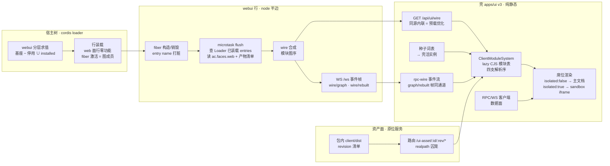

# webui 装载模型重造（webui-v3）——架构设计与实施规范

> 性质：域深设计——webui 装载模型（wire 投影 / 席位 / 隔离 / 主题行 / 独立部署）的终态规格。
> 状态：现行·方向锁；切片①②③全落（cr-925..932）+ 延后裁决五项收尾全清（cr-934..937）· cr-1008 2026-11-11 整理批检阅归位。
> 读者：改 webui 装载 / wire 面 / 前端行 / 主题包的人（余留后继项见下表）。

| 项 | 值 |
|---|---|
| 文档编号 | cr-923（2026-11-06 立档，同日吸收裁决六） |
| 状态 | 方向锁；切片①②③全落（cr-925..932）+ 延后裁决五项收尾全清（cr-934..937，2026-11-07）：isolated iframe v3 对接〔壳侧独立模块表沙盒宿主 + 席位占位 + 白名单代理（cr-934）；旧 ui-plugin-iframe.html/isolated-runtime 物理删除〕、bootUiClient 旧序列与 importmap 物理删除〔cr-933/934 完结〕、数据根出厂副本物理清理〔提纯函数化 + 契约锁（cr-935）〕、数据面主题包 v3 打包〔midnight 迁 v3 纯样式行 + wire themeId 面 + 构建器纯样式档（cr-936）〕、seat 审计面 v3 承接〔seats-audit-v3 三轴运行时门（cr-937）〕；全量 test:unit 绿（382 文件）。余留后继项（非本档收尾面）：combo 合并路由/chunks 优化、行移除不拆件〔卸载面归席位回收〕、种子深词全惰性化〔包结构债务〕 |
| 取代 | ui-plugin-selfhost.md（cr-919，含同日修订）；ui-plugin-form.md（cr-905）装载实现部分；webui-standalone-protocol.md（cr-912/917） |
| 上游裁决 | plugin-architecture-v2（cr-901）§4.3 web 面统一通道——零特权路径不动，装载机制本档再升级 |
| 参照系 | DSH 实物（行级实测，见 §8 参考来源） |
| 规范用语 | **必须 / 禁止 / 仅可** = 强制；偏离须先改本档 |

## 术语

| 术语 | 定义 |
|---|---|
| **wire** | 宿主与浏览器之间关于「装什么」的全部契约：一份 JSON 模块图清单（§4.3）。唯一获取方式 = GET + WS 事件帧（切片⓪裁决一：与 rpc-wire 合并通道）；同源内联仅为预载优化 |
| **种子词表** | 壳 in-bundle 持有的共享模块（vue/pinia/cordis/骨架件/webui-kit）到壳活实例的映射——通道 bundle 的单例契约面 |
| **factory 注册形态** | bundle 执行只注册工厂（`__ModuleLoader__.load({id, factory})`），模块体副作用全部延迟到首 import 物化时 |
| **revision URL** | 含内容修订段的资产地址（`/ui-asset/<id>/<rev>/index.js`）——HTTP 缓存语义由 URL 承担 |
| **行（row）** | 同 v2 术语：装配的最小单元。web 面行 = node 半边零功能、仅携带 `ac.faces.web` 声明的包 |

## 1. 背景与动机

### 1.1 推翻对象

现行 webui 装载链整体推翻：

- **锚点错误**：boot graph 锚在文件系统部署态（`pluginsDir` 目录扫描 →
  manifest/package.json 拼图 → HTTP 轮询端点），不是装配态。graph 与
  实际装配的一致性靠对账维护——`dirSignature` mtime 签名、
  `seedFactoryPlugins` 播种版本戳、双读窗口、升版重拷，每一个都是
  「图不是装配结果构造性投影」的并发症。
- **装载器自造复杂度**：每包一 bundle + importmap + 全局注册表
  （`__ac_channel_modules__`）+ 骨架共享收集（shared-modules）+ 
  auto-reload——全部服务于一个拼装式装载模型。
- **壳的同源硬假设**：graph/资产/WS 全相对路径，跨源支持只能以
  「standalone 模式」外挂（四层发现 + hello 握手 + 协议轴协商），
  既不能独立运行、又背着独立部署协议，两头不占。

### 1.2 保留物

- 零特权路径（工厂/第三方同通道同词法——cr-474 / v2 §4.3）；
- 宿主模块表单源（host-module-table）与构建期外部化不变量门；
- seats / isolated 词法；webui 分层求值语义（基座 − custom 停用 ∪ 
  installed(scope:webui)、点名缺席降级）；
- cr-919 修正后的产物裁决（唯一构建器 / entry 显式词形 / realpath 囚笼 /
  package.json 唯一 manifest）。

## 2. 设计原则

1. **一致性由构造保证，不靠对账**：wire = 活 fiber 集的投影；行装卸的
   瞬间 wire 跟着变，禁止任何签名/播种/双读机制再现。
2. **单一数据源**：装配态（loader）是唯一的「装什么」事实源；声明单源
   = 包 package.json `ac` 字段；构建器唯一（dev 与发版同一脚本）。
3. **壳零宿主假设**：壳是纯静态产物；宿主地址是配置不是模式；独立
   部署是部署选项，**禁止**为此引入协议。
4. **fail-loud 成对出现**：构建期纯度门（外部化不变量）与运行时解析
   throw 互为镜像，任何一侧不得静默兜底。

## 3. 总体架构



## 4. 架构设计

### 4.1 组件与职责

| 组件 | 位置 | 职责 | 禁止 |
|---|---|---|---|
| 宿主树 | apps/host boot | 分层求值 → 装载 web 面行（零功能 fiber） | 装载期 JS 副作用 |
| webui 行（node 半边） | apps/ui/src/webui-row.ts 重写 | 打脏/flush 对账、wire 合成、wire/graph·rebuilt WS 帧推送、资产路由 | 读数据根出厂产物 |
| 资产面 | 同上 | 包目录原位服务：revision URL + realpath 囚笼 + MIME 白名单 | 拷贝/播种 |
| 壳 v3 | apps/ui 重写 | createClient + 骨架 3 件 in-bundle + 模块表 runtime + RPC/WS 客户端（数据面 + graph/rebuilt 帧同通道）+ mount | 硬编码宿主地址 |
| 构建器 | apps/ui/scripts/build-channel.mjs | 唯一构建：TS/Vue → factory 注册 bundle + revision 清单 | 第二构建路线 |

### 4.2 装配与图成员资格

- web 面行经 **webui 基座文档**装载，在宿主进程内构成独立的 **webui
  fiber 域**——与 host 基座行零混杂（v2 §4.3 每进程基座文档族；行集
  互有重名，id 仅基座内唯一）。装载域独立的意义：webui 域 fiber 全为
  零功能行，装卸/停用只影响 wire，不可能波及 host 服务面；打脏/flush
  扫描面收窄到本域。**服务进程不拆**：浏览器单页需要 wire + 资产 + 
  RPC/WS 三类面，独立 webui 宿主进程 = 第二 origin 或纯反代，收益为
  负；「纯 webui 服务」场景由裁决六独立部署形态覆盖（静态壳 + 远程
  全功能宿主），不预建进程。停用 = 不装载 = 不进 wire（语义在装载层
  终结，不再有图层对账）。
- 点名缺席 / 第三方行解析失败 = 警告 + 跳过 + 上报（降级语义不变，上报面 = wire warnings 域）；
  **出厂行**缺席或解析失败 = fail-loud 上报（发布链 bug，非用户态）。

### 4.3 wire 规范

#### 4.3.1 schema

```jsonc
{
  "rev": "<图级修订>",            // rows 的 id+revision 序列化哈希；SSE 对账用
  "rows": [{
    "id": "ac-client-ui-todo",     // 行 id = cordis 插件名，全链寻址键
    "version": "2.x.y",           // 包版本——审计与等值判据，不参与装载
    "entry": "/ui-asset/<id>/<rev>/index.js",  // factory bundle；纯样式行可空
    "styles": ["/ui-asset/<id>/<rev>/tokens.css"],  // 附加 CSS（theme 行仅此）
    "inject": ["ac-client-ui-layout"],  // 依赖行——预取序 + 拓扑排序输入
    "seats": ["conversation:dock-widget"],  // 席位声明——渲染挂点
    "isolated": false,              // 执行档：true = sandbox iframe
    "themeId": "midnight"           // 可选——theme 行（ac.faces.web.theme 声明）
                                    // 投影的色板主题 id；壳装载时 registerThemeId。
                                    // theme 行 = 纯样式行：无 entry/seats，styles 必有，
                                    // 恒非隔离（cr-936 主题包 v3；旧链 theme:{tokensOnly}
                                    // 的 v3 声明面等价词）
  }],
  "seeds": { "vue": "^3.4", … },    // 种子词→版本区间（壳构建期生成）；行声明位 = 包 ac.faces.web.seeds（同词形区间）
  "warnings": ["…"]               // 降级/失败上报面（承接旧 boot-graph warnings 域：
                                  // 点名缺席 · 第三方解析失败 · 出厂行 fail-loud · 撞名防御）
}
```

字段处置（相对现行 BootGraphEntry）：保留 id/version/entry/styles/seats/
isolated；**退役** platform（单值无信息量）、base（被 revision URL 取代）、
channelImports（cr-905 已退役，双读窗到期即删）；**新增** inject、warnings、
themeId（cr-936 主题包——可选，仅 theme 行）。

#### 4.3.2 构建流程（宿主侧）

| 步 | 动作 | 说明 |
|---|---|---|
| 1 打脏 | fiber 构造/销毁事件 → entry name 进脏集 | 初始激活与稳态**同一实现**：激活趟种入全部名同步 flush，此后增量 |
| 2 flush | 逐脏名查 **Loader 已装载 entries**（活态） | 行名解析包位置（link: / npm / installed 物化位） |
| 3 声明 | 读包 `ac.faces.web` + 校验门 | entry 词形 / seats 词法；失败记 warnings 跳过。撞名防御：行 id 唯一性由装配层门禁承担（安装器既有检查），flush 层防御性警告 + 跳过后者（warnings 域上报） |
| 4 revision | 读包内 client/dist 产物清单（构建期生成）→ 拼 URL | 宿主只读清单，**禁止**现场算哈希 |
| 5 排序 | 按 inject 拓扑排模块图序 | 浏览器 ③ 支预取依赖的输入 |
| 6 送达 | 与上次 rev 不同 → WS `wire/graph` 帧（载荷仅 rev） | wire 本体获取**仅 GET**（单条拉取路径——切片⓪裁决一：通知走既有 /ws，SSE 端点不建）；同源 index 内联 = 后继预载优化（引入时测试矩阵翻倍，显式再立项） |

#### 4.3.3 送达与更新

- 获取：`GET /api/ui/wire`（全量，幂等）；更新通知走**既有 /ws 事件流**
  （切片⓪裁决一，2026-11-06 cr-924）：`wire/graph` 帧（载荷 rev，rev 变才发）
  与 `wire/rebuilt` 帧（dev watch / stat-poll 探测 bundle 重建）。
  合并依据：RPC 数据面 WS 已是强制依赖（独立部署本就要求 WS origin 放行），
  rpc-wire 已具备事件帧通道 + 退避重连 + 身份守卫；SSE 需在 web-server
  新增流式应答面（缓冲式 route 之外的第二应答形态）——纯新增复杂度零收益。
- 断连语义 = 重连重拉全量 wire；降级 UX 不承诺（同源/跨源共通，与
  部署位置无关）。

### 4.4 浏览器模块运行时（ClientModuleSystem）

lazy CJS 模块表，解析序四支 + 兜底：

```
import 'X' / require('X')
  ① 种子词命中   → 壳活实例（不进表，不物化）——单例契约面
  ② memo 命中    → 已物化 exports（物化一次恒等，副作用仅一次）
  ③ wire 行命中  → 按 revision URL 取 bundle → 执行（只注册）→ ④
  ④ factory 已注册 → 物化 factory(require) → 进 memo → 返回
  其余            → throw（loud）——构建期纯度门的运行时镜像
```

分工：①管单例、②管惰性、③管到达、④管物化。装载序无需外部编排，
依赖链经 require 递归自组织。

**种子词版本治理**：wire 顶层携带 ~seeds~ 表（种子词 → 壳活实例的
版本区间，壳构建期生成）；插件 ~ac.faces.web~ 声明 ~seeds~ 兼容区间。
flush 时对拍：区间不匹配 = warnings + 跳过（安装态可见）；物化时兜底
throw（防绕过）——跨大版本（如 vue 4）**禁止**静默炸，必须 loud。**退役**：importmap、`__ac_channel_modules__`、shared-modules 收集、
installChannelImportmap。

全局注册面（~window.__ModuleLoader__~）防御姿态定界：**装载协议面，
非安全边界**——同源页面脚本本就可写全局（现状亦是）；安全边界 = 
isolated 档（沙盒内无种子）+ 资产 realpath 囚笼。此界说不新增防御，
仅显式声明防止误当信任面。

### 4.5 产物与构建

| 项 | 裁决 |
|---|---|
| 构建器 | `build-channel.mjs` 唯一：dev 直调与发版 CI 调同一脚本同一产物位；`--out` 出参整体退役 |
| 产物位 | 包内 `<pkg>/client/dist/`：factory 注册 bundle + revision 清单；不入 git（.gitignore），npm 发包 files 含之 |
| entry 词形 | `ac.faces.web.entry = ./client/dist/index.js`（显式指产物，全仓同批切换）；package.json = 唯一 manifest |
| 构建必要性 | 与框架无关（React/Vue 对称：DSH 用 React 同样预构建）——TS/SFC 浏览器不可解析；factory 形态/外部化/纯度门是构建器职责 |
| 纯度门含版本对拍 | 构建期解析种子词版本区间随产物清单记录；与壳 ~seeds~ 表不匹配 = flush 警告跳过 + 物化 throw 兜底（§4.4） |
| 双半形态 | 同一包两半不同形态：node 半 TS 源直载（strip-only 运行时，npm main 可指 .ts——装载与声明是独立关注点）；web 半必须预构建。第三方作者：dev 由 ~ac plugin dev~ watch 顺带构建，publish 前置构建档（node 面「无构建步」裁决不覆盖 web 面） |
| 资产服务 | 原位直读包目录；realpath 囚笼（root 与 file 各 realpath 后前缀对拍，越出包根 = 403）；MIME 白名单（.map/.woff2/.wasm 等先行登记） |
| 缓存语义 | revision URL 承担（重建 = 新 URL = 天然失效）；ETag/304 降为兜底 |

### 4.6 渲染与执行档

```
物化 → 插件对象（default export）
  ├─ isolated:false（默认）→ ctx.plugin() 进壳 runtime → 席位渲染进主文档
  └─ isolated:true         → sandbox iframe 自行运行 + 席位内占位视图
                            + 父窗口白名单代理（安全语义不动）
```

iframe 是执行策略（安全档），不是装载机制。isolated 件在 iframe 内的模块表
= **独立表**（切片⓪裁决二，2026-11-06 cr-924）：isolated 行产物**自含**
（构建器按 ac.faces.web.isolated 分档，不做种子外部化——bundle 自带 vue
等依赖），iframe 内自建 ClientModuleSystem。种子代理否决依据：模块表
require 是同步的，跨 frame 只能 postMessage（异步）——同步 require 代理
结构性不可实现，除非引入异步模块协议（推翻 §4.4 惰性同步设计）；沙盒内
无共享单例需求（本就与主文档隔离）。沙盒内无种子 = §4.4 既有安全边界。

词形注记：v3 `isolated` 缺省 = false；现行 manifest 缺省 true
（build-channel `web.isolated !== false`）——cutover 语义翻转，切片②等值
验收白名单单列。

### 4.7 部署形态

| 形态 | 构成 | 额外要求 |
|---|---|---|
| 同源托管（缺省） | 宿主服务壳静态产物（首版 wire 走 GET；内联预载后继） | 无 |
| 独立部署 | 同一份静态壳 + 宿主地址单来源配置 | 宿主 CORS / WS origin 放行 |

独立部署是**部署选项非模式**：壳零宿主假设，无发现协议、无握手、
无版本协商（CORS 预检即版本面）。standalone 概念退役。

### 4.8 裁决清单（方向锁汇总）

| # | 裁决 |
|---|---|
| 一 | graph 锚 = 宿主活装配态（fiber 打脏/flush；boot-graph 端点/目录扫描/签名/播种全退役） |
| 二 | 浏览器运行时 = lazy CJS 模块表 + 种子词（importmap/全局注册表/shared-modules 退役） |
| 三 | 壳重做为最小壳；isolated iframe 降格为执行策略 |
| 四 | 产物承 cr-919 修正：唯一构建器 / entry 显式词形 / realpath 囚笼 / revision URL |
| 五 | 更新 = 事件驱动（WS wire/graph·wire/rebuilt 帧——切片⓪裁决一与 rpc-wire 合并通道；断连重拉全量） |
| 六 | wire 统一拉取（GET，内联仅优化）；独立部署去模式化，standalone 协议退役 |
| 七 | 通知通道 = 既有 /ws 事件流合并（SSE 端点不建——RPC WS 已是强制依赖，rpc-wire 重连/守卫复用） |
| 八 | isolated iframe = 独立模块表 + 自含产物（同步 require 不可跨 frame 代理——种子代理结构性否决） |

### 4.9 退役清单（cutover 时一并执行）

boot-graph 轮询端点 · pluginsDir 目录扫描 · dirSignature · 
seedFactoryPlugins · build-bundle dist/plugins 拷贝链 · manifest.json 迁移投影 · importmap · 
CHANNEL_MODULE_HOST（`__ac_channel_modules__`）· shared-modules · 
installChannelImportmap · ui-plugin-iframe.html · legacy-runtime · 
auto-reload · 四层发现与 hello 握手（cr-917 面）· 数据根出厂副本
（物理清理，复用 cr-918 手法）。

## 5. 实施流程

推翻式：分叉锁死 → 原型并行 → 全量通 → 一刀切换。**无双读窗口**（旧链
要么全在、要么全无；回滚 = 整批 revert）。

**切片⓪（分叉决策迷你 CR，切片①动工前置）——已决（2026-11-06 cr-924）**：

| 分叉 | 裁决 | 记录 |
|---|---|---|
| SSE 与既有 WS（rpc-wire）合并 vs 并行 | **合并**：wire/graph·wire/rebuilt 帧走既有 /ws 事件流，SSE 端点不建 | §4.3.3 / 裁决七 |
| isolated iframe：独立模块表 vs 种子代理 | **独立表**：isolated 行自含产物，iframe 内自建模块表 | §4.6 / 裁决八 |

验收 = 无悬空分叉 ✓。

| 切片 | 范围 | 验收 |
|---|---|---|
| ① 原型（最小可跑） | **最先写打脏/flush 穿透测试**（装载/卸载/停用三
   动作 → wire 增删行——fiber 事件时序与 loader 内部表可读性是全方案
   地基，测试先行而非最后验）→ 宿主 webui 行 v3（打脏/flush + wire + 
   SSE）+ 壳 v3（模块表 + 种子表 + 骨架 3 件）+ build-channel factory 形
   态与 revision 清单 + wire/清单 schema 落 ac-webui-core 纯函数 | todo
   一件通：声明 → 装载 → wire → 物化 → 席位渲染；e2e 新建 |
| ② 全量通（30 通道包——33 ac-client-ui-* − 骨架 3 件 in-bundle（**前置：回滚演练**——无数据双读窗口下回滚是唯一安全网，
   安全网在走钢丝前验证：全量通阶段先整批 revert 一次，确认旧链可跑
   再继续） | 32 包产物切换 · isolated 档对接 · revision 资产（combo 可
   后继，首版逐包注入）· 独立部署冒烟（静态壳 + 配置 + CORS） | 装
   配链 e2e 全量；语义等值 = manifest version + 构建戳 + SHA-256 清单
   （差异白名单制），**禁止**逐字节判据；**立项 CR 单列受影响测试清单**
   （boot-graph / graph 断言面重写清单，32 包全量切换的验收对象显式化） |
| ③ cutover + 退役 | §4.9 清单一并执行；plugin-architecture-v2 §五改义与备份口径更新（v2 §五规范口径；ac-backup 旧代实现不在本批） | 数据根无出厂件；boot 等值；全量 e2e 绿；回滚演练（整批 revert 后旧链可跑） |

每片 CR **必须**含：验收判据（对哪些既有 e2e/单测负责）/ 开关 / 回滚点。

## 6. 注意事项（风险与开放问题）

| # | 事项 | 状态/归属 |
|---|---|---|
| 1 | web 面行进宿主树的 inject 面与 fiber 生命周期细节（打脏/flush 依赖 fiber 事件时序与 loader 内部表可读性——全方案地基） | 穿透测试切片一最先写（§5 切片①） |
| 2 | isolated iframe 与模块表相容 | 已决：独立表 + 自含产物（§4.6 裁决八）；sandbox 白名单安全语义不动 |
| 3 | 通知通道与既有 rpc-wire WS 合并还是并行 | 已决：合并（§4.3.3 裁决七） |
| 4 | combo 合并路由首版可缓（逐包注入已满足）；chunks 优化对齐 DSH comboUrl | 后继立项 |
| 5 | 升级代际混跑天然免疫（原位读恒赢，数据根残留不被读取） | 切片三物理清理收口 |
| 6 | Windows link 跨盘 / 私域 registry | 承 v2 §九.5 |
| 7 | 通道 bundle 体积：lazy 物化后首屏成本 = 骨架 + 首屏行；revision 缓存跨会话有效 | 观察项，combo 后继时复核 |

红线提醒：**禁止**重新引入签名/播种/双读类对账机制（原则 1）；**禁止**
为独立部署新增协议面（原则 3）；**禁止**逐字节等值验收（构建环境差异
天然存在）。

## 7. 与既有文档的关系

| 文档 | 关系 |
|---|---|
| plugin-architecture-v2.md | §4.3 零特权路径不动；装载机制升级为本档；§4.5 web 面不新增指纹面 |
| ui-plugin-form.md（cr-905） | 模块表单源/外部化门/seats 词形保留；装载实现被取代 |
| ui-plugin-selfhost.md（cr-919） | 归档被取代；产物裁决由 §4.5 承继 |
| webui-standalone-protocol.md（cr-912/917） | 归档被取代（裁决六） |

## 8. 参考来源

DSH 实物（2026-11-06 行级实测，桌面运行时 `app.asar\dsh\node_modules\@deepseek-ai`）：

| 机制 | 文件 | 本档对应 |
|---|---|---|
| 图合成 + 打脏/flush 对账 + lazy CJS 解析序 | dsh-client-modules/lib/index.js | §4.2 / §4.3.2 / §4.4 |
| dsh.client 声明实样（inject/platform + lib/client.js 679KB factory 注册 bundle，React 同样预构建） | dsh-client-ui-chat/package.json · lib/client.js 头部 | §4.5 |
| SSE 事件通道 + stat-poll 轮询设计理由（网络挂载无 inotify） | dsh-client-hmr/lib/index.js | §4.3.3 |
| 安装位置直读 dist（零拷贝防穿越） | dsh-host-frontend-static/lib | §4.5 |

内部：cr-474（零特权路径）· cr-843（资产应答压缩/ETag 先例）· cr-905
（统一通道四切片）· cr-917（standalone 切片一，本档退役其面）· 
cr-918（数据根收口手法）· cr-919/920（产物与通道壳裁决）。

## 9. 附录：UI 插件开发与安装推演（my-widget 全生命周期）

### 9.1 包结构与产物细节

```
my-widget/
  package.json        # name · keywords:[agentchat-plugin] 自标 · engines
                      # main → src/index.ts（node 半 TS 直载）
                      # ac.faces.web = { entry: ./client/dist/index.js,
                      #   seats:[...], isolated } · files 含 client/dist
  src/index.ts        # node 半（UI 件通常零功能或仅配置声明）
  client/index.ts     # web 半源（import widget.vue；default export 插件对象）
  client/widget.vue   # SFC
  client/dist/        # 唯一构建器产物（.gitignore 不入 git，publish 随包）
    index.js          # factory 注册 bundle（见下）
    tokens.css        # styles（theme 类行/带皮肤件）
    manifest.json     # revision 清单（构建期生成，宿主只读不算）
```

index.js 形态（factory 注册 + 外部化）：

```js
window.__ModuleLoader__.load({
  id: "my-widget",
  factory: (require) => {
    let vue = require("vue");            // 种子词 → 壳活实例（构建期 external 留空）
    let layout = require("ac-client-ui-layout");  // wire 行 → ③ 支
    ... // 模块体 + CSS 注入全在闭包内，物化时才执行
    return { default: { name, apply(ctx) {...} } };
  },
})
```

manifest.json（revision 清单）：`{ rev: "<内容哈希>", builtAt, files: 
{ "index.js": {hash, size}, "tokens.css": {...} } }`——宿主 flush 拼URL、
资产路由对账、publish 构建档校验共用这一份。

### 9.2 开发流程（作者）

| 步 | 动作 | 机制 |
|---|---|---|
| 1 脚手架 | `ac plugin init my-widget` | 零占位符包形态 + owner 私有工具模板 |
| 2 dev 双面 | `ac plugin dev` | node 面：壳进程会话级装载（watch + `?t=` 穿透热重载）；web 面：dev 构建器 watch → 重建 `client/dist/` |
| 3 生效链 | 改源码 → bundle 重建 → 宿主 stat-poll 探测 → **rebuilt 帧** → 浏览器重取 bundle、失效 memo → 席位即时更新 | 全程无重启、无手动刷新 |
| 4 纯度自检 | 构建器外部化不变量门 | 产物剩余 import ⊄ 宿主模块表 = 构建失败（loud） |
| 5 发布 | `ac plugin publish` | 门禁：admissionOf（keywords/engines/依赖）+ **web 面前置构建档**（client/dist 存在且与 revision 清单一致）→ npm publish（node 半 TS 源直发 + web 半 dist 随包） |

### 9.3 安装流程（用户，三入口同一安装器）

市场一键 / 对话安装 / CLI → 统一安装器：

```
① npm 形态落位：profile/ pnpm 安装（lock 锚定，ignore-scripts 强制）
② 门禁：ac 字段校验 · engines · 依赖声明 · web 面 ui 权限/高危席位评审
   （免审 ≠ 无门禁——v2 §4.5）
③ 登记：安装器代写 installed.patch.yml
   （- id: my-widget / name: my-widget / scope: webui / owner 锚）
④ 激活：宿主 webui fiber 域动态装载该行（fiber 构造）
   → 打脏 → microtask flush：行名解析 → 安装根 node_modules/my-widget
   → 读 package.json ac.faces.web + client/dist/manifest.json → wire +1 行
   → SSE graph 帧 → 浏览器 ③ 支按需拉 bundle 物化 → 席位出现
⑤ 回执两轴：applied × live（全程无重启）
```

资产服务：`GET /ui-asset/my-widget/<rev>/index.js` → realpath 囚笼（包根
= 安装根落位）→ MIME 白名单 → revision URL 永久缓存。

### 9.4 卸载与升级（对称）

卸载：installed 行移除 → fiber 销毁 → flush → wire −1 行 → SSE → 浏览器
拆件（席位回收）；包物理卸载随数据根治理。升级 = 换版本重装：lock
diff 审批卡 → 新包落位 → fiber 重建 → 新 rev URL 天然失效旧缓存。

